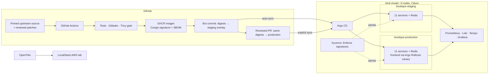

# DevSecOps & GitOps Platform for Online Boutique

A production-style delivery platform built around Google's
[Online Boutique](https://github.com/GoogleCloudPlatform/microservices-demo):
11 microservices in 5 languages, pinned to upstream `v0.10.7`. The application is
not modified. This repository owns everything around it, from the vulnerability
patches through admission, deployment, observability and recovery.

Every claim below is backed by a recorded run. See
[IMPLEMENTATION_STATUS.md](IMPLEMENTATION_STATUS.md) for evidence, run IDs and
known limits.

---

## Highlights

| Area | What is in place | Evidence |
| --- | --- | --- |
| **Supply chain** | All 11 images rebuilt from pinned source with a reviewed patch set. Each is scanned by Trivy (HIGH/CRITICAL gate), signed with Cosign keyless, and gets a CycloneDX SBOM. | Release run 42245962626 |
| **Admission control** | Kyverno **Enforce**: only images signed by this repo's release workflow, or two reviewed digest-pinned exceptions, run in the app namespaces. 2 admission replicas. | Signed image admitted; upstream, untrusted and tag-only images rejected |
| **GitOps** | Argo CD. Staging deploys automatically from `main`. Production needs a reviewed PR **and** an explicit sync. | First signed release promoted via PR #2 |
| **Progressive delivery** | Argo Rollouts canary for the storefront. 50% step, a checkout analysis against candidate Pods only, **automatic abort**. | Drill: broken build aborted, good build promoted |
| **Network security** | Cilium default-deny with an explicit allow-list per service. Staging cannot reach production. Hubble for flow inspection. | `make verify` isolation checks |
| **Workload hardening** | Restricted Pod Security, non-root, read-only root FS, dropped capabilities, quotas, PDBs, digest-pinned images. | Manifest tests (22) |
| **Observability** | Prometheus, Grafana, Loki, Tempo, OpenTelemetry Collector, Alloy, a blackbox storefront probe, and alerts that include canary aborts. | Probe and trace span-metric series queried |
| **Data** | Persistent Redis volumes with checksum-verified backup and restore into a fresh volume. | Production backup restored and loaded (16 keys) |
| **Resilience** | 2 replicas and PDBs per service, spread across workers. | Worker stopped for 8 min: 28 of 29 checkouts succeeded, recovered within ~45 s |
| **Infrastructure as code** | OpenTofu → LocalStack AWS lab (S3 → SQS → Lambda → DynamoDB plus DLQ) with a plan guard that blocks deletions and replacements. | Idempotency and DLQ checks pass |

## Architecture



### Release flow

1. **Build:** `release.yml` applies the reviewed patches in `build/patches/` to the
   pinned upstream commit and builds all 11 images.
2. **Gate:** Trivy blocks HIGH/CRITICAL findings and Gitleaks blocks committed
   secrets. Nothing is published unless every check passes.
3. **Publish:** images are pushed to GHCR, signed with Cosign (GitHub OIDC,
   keyless, Rekor transparency log), and attested with an SBOM.
4. **Stage:** CI re-pulls each image anonymously, runs the manifest tests, and
   commits the digests to the staging overlay. Argo CD deploys it, and the frontend
   change goes through the canary.
5. **Promote:** a reviewed PR copies the same digests to production. Nothing is
   rebuilt. An operator runs the explicit sync, and the canary runs again with 2
   replicas.
6. **Admit:** in both namespaces Kyverno rejects any Pod image that is not signed by
   this workflow on `main`.

### Canary with automatic abort

The frontend Deployment is only a Pod template, held at 0 replicas. A `Rollout`
references it through `workloadRef`. A new version first gets 50% of the replicas.
An AnalysisRun then executes the full customer journey three times (browse,
product, cart, mock order) against `frontend-canary`, which selects only the
candidate Pods. Any failure aborts automatically, and the stable Pods keep
serving. `make canary-drill` exercises both outcomes on production and returns
it to the Git-defined state.

## Tech stack

**Kubernetes:** kind 0.33 (K8s 1.36), Cilium 1.20 + Hubble, Kustomize
**Delivery:** GitHub Actions, Argo CD, Argo Rollouts 1.10, GHCR
**Security:** Trivy, Gitleaks, Cosign/Sigstore, CycloneDX SBOM, Kyverno 1.19,
Pod Security Admission, NetworkPolicy
**Observability:** kube-prometheus-stack, Grafana, Loki, Tempo, OpenTelemetry
Collector, Grafana Alloy, blackbox exporter
**IaC:** OpenTofu 1.13, AWS provider 6.72, LocalStack
**Tooling:** Python (tests, verification, drills), Bash, Make

## Quick start

Requirements: Linux, Docker, kind 0.33, kubectl 1.36, Helm 3.22, Python 3.12+
(`pip install -r requirements-dev.txt`), about 16 GB of free RAM. Read the
[host prerequisites](docs/operations.md) first; the inotify limits must be raised.

```bash
make test               # manifest, canary, admission and plan-guard tests
make cluster-up         # 3-node kind cluster with Cilium
make gitops-up          # Argo CD + the two Boutique applications
make observability-up   # metrics, logs, traces, dashboards, alerts
make rollouts-up        # Argo Rollouts controller
make security-up        # Kyverno + signature policy
make verify             # checkout in both environments + isolation checks
```

| Command | Local address |
| --- | --- |
| `make storefront` | http://127.0.0.1:18081: staging |
| `make production` | http://127.0.0.1:18082: production |
| `make argocd` | Argo CD UI |
| `make hubble` | http://127.0.0.1:12000: network flows |

All tooling uses `.platform/kubeconfig` with context `kind-devsecops-platform`, and
every port forward binds to loopback.

### Operational drills

```bash
bash scripts/finish-platform.sh                     # admission proofs, Redis restore, worker-loss drill
make canary-drill                                   # broken build aborts, good build promotes
python3 scripts/redis-snapshot.py production backup .platform/backups/prod.rdb
python3 scripts/redis-snapshot.py production restore .platform/backups/prod.rdb new-claim
bash scripts/check-release.sh production --sync     # explicit production promotion + evidence
make aws-up aws-plan aws-apply aws-verify           # LocalStack lab (token required)
```

## Repository map

| Path | Contents |
| --- | --- |
| `apps/online-boutique/` | Vendored upstream manifests, staging and production overlays, canary resources |
| `platform/` | kind topology, pinned versions, Helm values, Argo CD apps, Kyverno policy |
| `build/` | Reviewed upstream patches, lockfiles, Python constraints |
| `.github/` | `validate`, `review-images` and `release` workflows |
| `infra/localstack/` | OpenTofu AWS lab and pinned Lambda sample |
| `scripts/` | Provisioning, verification, drills, release tooling |
| `tests/` | Independent checks for manifests, policies, canary contract and plan guard |
| `docs/` | [Architecture & decisions](docs/architecture.md) · [Delivery](docs/delivery.md) · [Operations](docs/operations.md) · [AWS lab](docs/aws-lab.md) |

## Known limits

This is a local, production-style platform, not an Internet-facing deployment:

- **One host, one control plane.** The three nodes are containers on a single
  machine, so a worker can be lost but the host cannot.
- **Single-replica Redis per environment** on a node-local volume. Losing that
  node means restoring from backup.
- **Replica-ratio canary.** There is no service mesh, so about half of real
  traffic reaches the candidate during analysis. Only the frontend is canaried.
- **Two third-party images** (busybox, redis) are trusted by reviewed digest
  rather than by signature.

## License

The Online Boutique manifests keep Google's Apache-2.0 license (`apps/online-boutique/base/LICENSE`). The LocalStack
Lambda sample keeps its license in `infra/localstack/sample/`.
