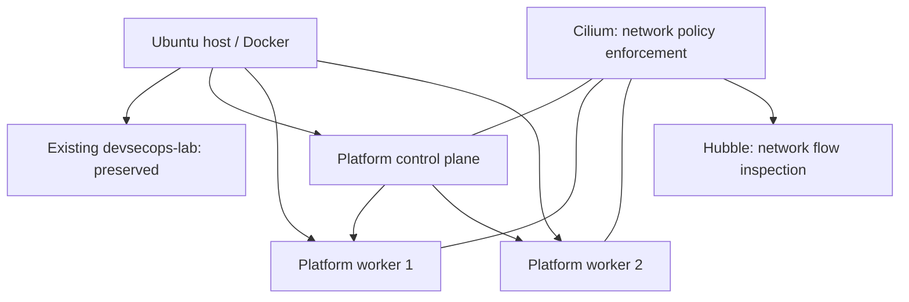
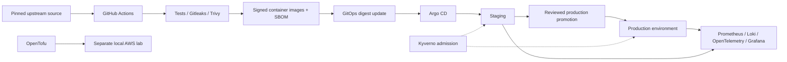
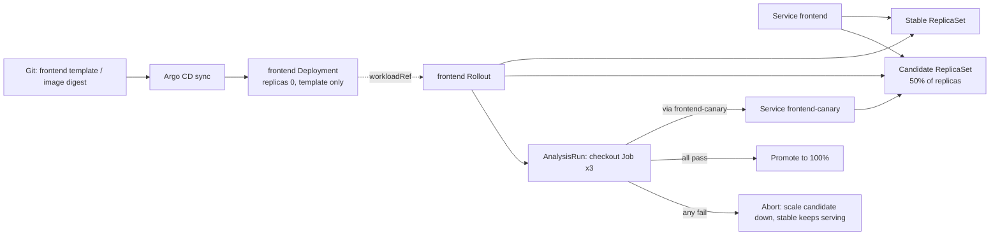
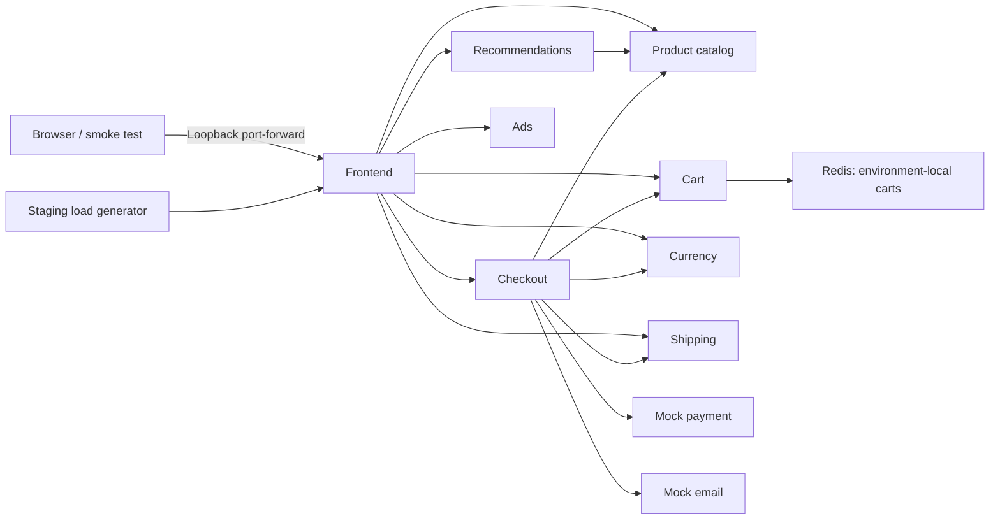

# Platform architecture

Status: foundation implementation in progress. The target delivery and telemetry
systems below are planned until marked verified in `IMPLEMENTATION_STATUS.md`.

## Approved local topology

The platform uses `.platform/kubeconfig` and context `kind-devsecops-platform`.
The API listens on loopback. Pod CIDR is `10.246.0.0/16`; Service CIDR is
`10.112.0.0/16`, separate from the old lab. Cilium uses Kubernetes IPAM and
retains kube-proxy. One control plane is not HA; all three nodes share a physical
host. This simulates worker loss, not host-level disaster tolerance.

## Target delivery architecture

## Architecture decisions

| Date | Decision | Rationale / trade-off |
| --- | --- | --- |
| 2026-11-05 | Separate three-node cluster | Preserve existing work; permit worker recovery tests; consumes more RAM. |
| 2026-11-05 | Platform repository separate from upstream | Own infrastructure and delivery history without modifying application features. |
| 2026-11-05 | Pin Online Boutique v0.10.7 commit and workload digests | Reproduce the existing working baseline; upgrades must be explicit. |
| 2026-11-05 | Cilium with Hubble | Enforce network policies and inspect flows; more components than kindnet. |
| 2026-11-05 | Staging and production namespaces in one cluster | Affordable local promotion and isolation testing; shared control plane and host. |
| 2026-11-05 | Private `oussema-code/devsecops-platform` GitHub repository | Approved hosting destination for platform source and GitHub Actions. |
| 2026-11-05 | Build all eleven application images | Complete delivery coverage, with additional GitHub runner time. |
| 2026-11-05 | Production requires explicit Argo CD sync | Separate configuration promotion from operator deployment approval. |
| 2026-11-05 | Public upstream-derived GHCR images | Anonymous cluster pulls; platform repository stays private. |
| 2026-11-05 | Persistent Redis volumes plus backup/restore | Carts survive Pod restarts; node loss needs a restore. |
| 2026-11-05 | Maintain a reviewed patch set for the eleven image builds | Independent remediation path; patches are this project's maintenance. |
| 2026-11-05 | Kyverno signatures in Audit until the first signed release | Running upstream images keep working; switch to Enforce afterwards. |
| 2026-11-06 | Enforce: platform-signed images plus two digest-pinned third-party images | busybox and redis are not rebuilt by this project; their exact digests are reviewed exceptions. Two admission replicas so node loss cannot block Pod replacement. |
| 2026-11-05 | Maintained LocalStack with a locally supplied token | Current emulator; requires a free account token kept out of Git. |
| 2026-11-06 | Canary the frontend first with checkout analysis and automatic abort | Customer-journey check on the candidate; backends need their own checks later. |

## Frontend canary

## Application request flow

Each environment has its own copy of this graph. Internal calls use stable
Kubernetes Service names and gRPC, except Cart-to-Redis. Cilium permits only the
declared dependency edges and DNS. No application edge crosses namespaces.
Production's ten stateless services run two replicas; Redis remains one replica.
Staging also runs the load generator. No ingress controller or public endpoint
has been introduced.

## Sources

- [Cilium on kind](https://docs.cilium.io/en/stable/installation/kind/)
- [Online Boutique pinned source](https://github.com/GoogleCloudPlatform/microservices-demo/tree/5b608cb1dfe317d05e4f1bb8c99b7618452fde87)
- [Argo CD automated reconciliation](https://argo-cd.readthedocs.io/en/stable/user-guide/auto_sync/)
- [Argo Rollouts workloadRef](https://argo-rollouts.readthedocs.io/en/stable/migrating/#reference-deployment-from-rollout)
- [Argo Rollouts Job analysis](https://argo-rollouts.readthedocs.io/en/stable/analysis/job/)
