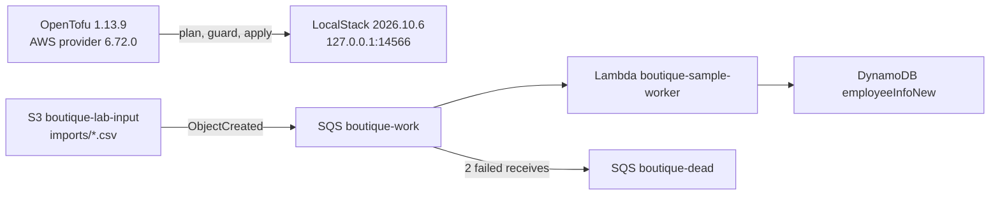

# AWS lab (OpenTofu + LocalStack)

A separate, local AWS environment. It is not connected to the Kubernetes platform.
It practises infrastructure-as-code against an emulator before any real account.

The Lambda is AWS's public `cdk-s3-sqs-lambda-dynamodb` sample, pinned to commit
`7925d558…` with its license in `infra/localstack/sample/`. IAM grants it only
the queue, object prefix, table and log group it uses.

## Run

1. Put a LocalStack auth token in `.platform/localstack.env` with your editor
   (`LOCALSTACK_AUTH_TOKEN=...`). The file is private and ignored by Git. Never
   paste the token into chat, commits or CI logs.
2. `make aws-up` starts the pinned emulator on loopback with persistent state.
3. `make aws-plan` packages the worker, validates, saves a plan, and runs
   `scripts/plan-guard.py`, which rejects any deletion or replacement.
4. `make aws-apply` re-checks that saved plan and applies exactly it.
5. `make aws-verify` uploads a CSV and delivers the same record twice. It checks
   that DynamoDB holds one correct item (idempotent processing). It then sends a
   message for a missing object and confirms it reaches the DLQ.
6. `make aws-down` stops the emulator and keeps its state.
   `CONFIRM=boutique-aws bash scripts/aws-lab.sh destroy` deletes the lab irreversibly.

CI runs `tofu fmt -check` and `tofu validate` on every push. It never starts
LocalStack or uses a token. State lives in `.platform/tofu/` and never in Git.
